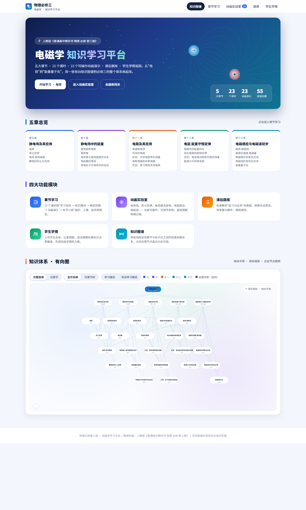

# 物理必修三 · 电磁学学习平台

> 本仓库为学习材料汇总库，未来会把小学、初中、高中的材料都汇总于此。

## 在线访问

**直接打开网站（无需 GitHub）：<https://kobebryand2023.github.io/-/>**

基于人教版《普通高中教科书 物理 必修 第三册》开发的**单文件静态网页学习平台**，覆盖静电场、电路、电能与电磁感应全部五章内容，用于上课演示、学生自学与课后练习。所有资源内嵌在一个 HTML 文件中，**离线可用、无需安装、无需后端**。



## 功能特性

| 模块 | 说明 |
| --- | --- |
| **知识体系有向图** | 首页以有向图呈现"1 根节点 + 5 章 + 23 小节"的知识体系与前置依赖关系（26 条有向边），支持拖拽平移、滚轮缩放、完整图谱/仅章节切换、"学习路径"标号，点击任意节点直达对应章节或小节 |
| **章节授课** | 23 节课按"学习目标 → 知识精讲 → 典型例题 → 动画演示 → 本节小结"组织，公式用内联排版，每节带侧边目录与上/下一节导航；配色分章（第九章蓝 / 第十章紫 / 第十一章橙 / 第十二章绿 / 第十三章青） |
| **动画实验室** | 23 个可操作 Canvas 动画演示（静电感应、库仑定律、电场线、电容器充放电、电磁感应、电磁波、能级跃迁等），滑杆/按钮/下拉实时调节参数并显示读数 |
| **课后题库** | 收录教材"练习与应用"经典题 55 道（选择/概念/计算），支持按章多选筛选、题型筛选、关键词搜索、随机顺序、逐题查看答案与解析 |
| **学生学情** | 上传/粘贴学生名单（CSV/TXT），逐题标记错题，自动换算每位学生各章知识点掌握度，形成班级学情统计 |

## 快速开始

1. 下载 `物理必修三·电磁学学习平台.html`
2. 用浏览器（Chrome / Edge / 其他现代浏览器）双击打开即可使用

> 数据说明：全部数据（知识点、题目、动画逻辑）均内嵌于 HTML，无任何外部依赖；学生名单与错题记录仅保存在本机浏览器 localStorage 中，不会上传到任何服务器。

## 技术说明

- 纯原生 HTML + CSS + JavaScript，无构建工具、无框架依赖
- 页内 hash 路由（`#/home`、`#/learn/<节>`、`#/sim/<演示>`、`#/quiz`、`#/students`）
- Canvas 2D 实现可交互动画演示，`requestAnimationFrame` 驱动
- SVG 实现知识图谱（分层布局、有向边、点击跳转）
- 响应式适配桌面与移动端
- 中文字体使用自托管镜像加载，加载失败时回退系统字体

## 目录结构

```
physics-b3/
├── 物理必修三·电磁学学习平台.html   # 学习平台（单文件，全部功能）
├── README.md                        # 本说明
└── assets/
    └── home.png                     # 首页截图
```

## 内容依据

知识点与例题依据人教版《普通高中教科书 物理 必修 第三册》编写，课后题取自各章"练习与应用"，供教学与自学参考。

## License

仅供学习交流使用。
